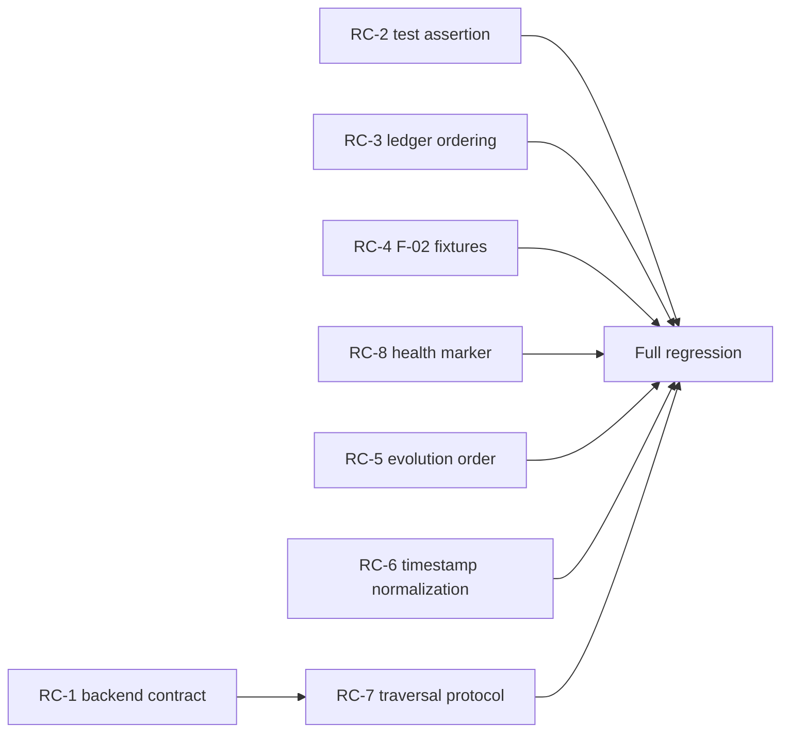

# S2P Test Migration Design

**Date:** 2026-10-05  
**Status:** DESIGN COMPLETE  
**Scope:** Diagnose and design the migration of the S2P backend test suite after removal of `SQLiteGraphStore`. This document makes no source or test-code changes.

## 1. Summary

The full backend suite currently collects 2,250 tests and reports **2,187 passed, 18 failed, and 45 setup errors**. The target is **2,250 passed, 0 failed, and 0 setup errors**, preserving the test inventory by migrating obsolete tests instead of deleting coverage.

The 63 non-passing cases reduce to eight root causes. Forty-six cases come from one incomplete backend-cutover boundary: `app/s2p_graph_status.py` and its tests still treat `sqlite` as the test/default/rollback backend even though the SDK factory accepts only `memory` and `age`. The remaining failures expose stale test ordering assumptions, aggregate-only conservation fixtures invalidated by F-02, nondeterministic evolution ordering, ISO timestamp parsing, a private AGE traversal bridge, and a production-readiness test double that no longer satisfies the public marker protocol.

Production changes are required. They are limited to replacing retired SQLite policy, making deterministic protocol-level behavior explicit, and removing private backend traversal coupling. No fix may reintroduce `SQLiteGraphStore`, `DecisionStore`, a query-serving cache, fabricated conservation rows, or static conservation JSON.

### Failure totals by root cause

| Category | Root cause | FAIL | SETUP_ERROR | Total |
|---|---|---:|---:|---:|
| RC-1 | Legacy SQLite active-backend configuration and rollback contract | 1 | 45 | 46 |
| RC-2 | Stale concrete `SQLiteGraphStore` consolidation assertion | 1 | 0 | 1 |
| RC-3 | Test double reverses already canonical event ordering | 2 | 0 | 2 |
| RC-4 | F-02 conservation tests still fabricate or intercept aggregate counts | 2 | 0 | 2 |
| RC-5 | Evolution summary family order depends on store read order | 1 | 0 | 1 |
| RC-6 | ISO graph timestamps are parsed as floats in shared ordering code | 2 | 0 | 2 |
| RC-7 | S2P graph reader uses private AGE internals and assumes a legacy row shape | 7 | 0 | 7 |
| RC-8 | Health test double lacks `ProductionReadyStore` marker property | 2 | 0 | 2 |
| **Total** |  | **18** | **45** | **63** |

## 2. Root-cause categories

### RC-1 — Legacy SQLite active-backend configuration and rollback contract

**Affected cases:** A-04 and A-19 through A-63 in Appendix A (46 cases).

`app/s2p_graph_status.py` still defaults test/non-production configuration to `sqlite`, permits only `sqlite` or `age`, reports SQLite as authoritative, and exposes rollback instructions that select SQLite. The test bootstrap was partially changed to `memory`, but individual modules reconstruct `S2PActiveGraphConfig` through the stale production policy. This creates 45 setup errors before their bodies run; the live rollback test reaches the SDK factory and fails because `sqlite` is no longer a valid backend.

**Fix strategy:** migrate the public S2P active-backend contract to the two supported values, `memory` and `age`. Test/dev defaults and rollback use `memory`; production remains fail-closed and requires a valid AGE configuration. Replace SQLite-specific status fields, warnings, and instructions with backend-neutral authority/readiness fields. Migrate every affected test one-for-one: assertions about local test fallback use memory, while product-mode tests assert AGE or an unavailable/fail-closed state. Retire only the semantic claim that production can roll back to SQLite; replace that test with a no-local-production-fallback assertion so test count does not drop.

**Risk:** production and tests. Medium-high because the graph-status payload is public and callers may depend on SQLite-named fields. Before implementation, search app/front-end consumers and either migrate them atomically or retain a short, explicitly deprecated response alias without accepting SQLite as a backend.

### RC-2 — Stale concrete backend assertion

**Affected case:** A-03.

`test_s2p_uses_canonical_inmemory_graphstore_with_prefix` imports or asserts `SQLiteGraphStore`, while the composed scorer now exposes `LegacySignalFilteringGraphStore` around the supported graph store. The test validates a deleted implementation instead of the public ownership and namespace behavior.

**Fix strategy:** remove the concrete SQLite import and assert through public protocols. Resolve wrapper ownership through `GraphStoreWrapper.graph_primary`, confirm the terminal test/dev store is `InMemoryGraphStore` only at the composition-root test boundary, and retain the behavioral assertion that S2P domain/prefix isolation works.

**Risk:** test-only, low.

### RC-3 — Double reversal in compounding-ledger test store

**Affected cases:** A-01 and A-02.

The `LedgerGraphStore` test double reverses `get_evolution_events()` output. `InMemoryGraphStore` now returns the canonical newest-first shape, and `CompoundingLedger` performs the ordering conversion it needs. The stale reversal makes the trajectory and conservation history appear backward.

**Fix strategy:** remove only the test double's reversal; preserve its event filtering and fixture behavior. Keep production ledger code unchanged and assert explicit chronological output at the public ledger boundary.

**Risk:** test-only, low.

### RC-4 — Aggregate-only conservation fixtures after F-02

**Affected cases:** A-05 and A-07.

F-02 intentionally removed count-based fabrication. One test monkeypatches an obsolete `conservation_status` seam, so no call is captured. Another supplies only aggregate counts and expects a populated score waterfall; the live SDK correctly fails closed because no verified decision rows exist.

**Fix strategy:** migrate the coverage test to the live `compute_conservation_status_payload`/`check_conservation` boundary and assert the real category coverage payload. Seed actual verified decisions and outcomes in `InMemoryGraphStore` for the browser/cache test, then spy on the supported read/cache seam. Rows must include canonical `created_at` and `decision_id` fields and be ordered through the shared helper. Do not fabricate rows from counts.

**Risk:** test-only, low.

### RC-5 — Nondeterministic evolution family ordering

**Affected case:** A-06.

`get_evolution_summary()` takes family order from first-seen graph variant records. Store read order is not an API-level ordering guarantee, so the endpoint returns `evidence, escalation, routing, triage` while the domain configuration specifies `evidence, routing, escalation, triage`.

**Fix strategy:** derive known family order from the canonical `_INITIAL_VARIANTS`/S2P variant configuration, then append unknown dynamically introduced families in a deterministic order. The endpoint must not depend on graph backend read order.

**Risk:** production code, medium. The change stabilizes output order without changing variant contents.

### RC-6 — ISO timestamps parsed as floats

**Affected cases:** A-08 and A-09.

`LegacySignalFilteringGraphStore.get_decisions()` sorts by calling `float(created_at)`. AGE-canonical timestamps are ISO strings such as `2026-01-21`, producing `ValueError`. The same assumption is latent in shared `chronological_decisions()` behavior, which must define one canonical comparison for memory and AGE rows.

**Fix strategy:** add one shared decision ordering key in copilot-sdk that accepts numeric epochs and ISO-8601 strings, normalizes to an aware UTC instant, and uses `decision_id` as the stable tiebreaker. Use it in `composite_gate.chronological_decisions()` and `legacy_signal_filter.py`; add tests for numeric, ISO, mixed-order, and equal-time rows. Do not branch by backend identity.

**Risk:** shared SDK production code, medium-high. Incorrect timezone normalization could silently select the wrong rolling window, so focused SDK tests and the S2P shadow tests are mandatory.

### RC-7 — Private AGE traversal bridge and legacy result shape

**Affected cases:** A-10 through A-16.

`S2PGraphReader` unwraps private `_store` chains and calls AGE-private query/conversion methods. The wrapper chain is now deeper, and the generic protocol fallback returns a different result shape than the reader's assumed `{"node": ...}` rows. This causes missing nodes, unavailable directed queries, missing context, and incorrect factor vectors. It also violates the protocol-only consumer boundary.

**Fix strategy:** introduce a small S2P-owned, runtime-checkable `S2PContextTraversalStore` protocol with public bounded operations `query_direct_context(...)` and `query_duplicate_context(...)`. Implement/delegate those operations in the S2P active-store wrapper and the ci-platform AGE adapter/store. `S2PGraphReader` must use only that protocol and fail closed when it is absent; it must not unwrap `_store` or call `_run_query`, `_S`, or `_node_to_dict`. Test doubles implement the same public protocol. Perturbation setup that mutates AGE data belongs in an explicit test/admin client fixture, not in the consumer reader.

**Risk:** production code across S2P and ci-platform, high. Query bounds, domain scoping, and row schema must be defined in the protocol tests before the S2P reader is migrated.

### RC-8 — Production-readiness marker missing from health test double

**Affected cases:** A-17 and A-18.

The health builder now classifies stores via the runtime-checkable `ProductionReadyStore` marker. `HealthAGEGraphStore` inherits a concrete AGE test double but does not expose `production_ready`; the resulting 503 is correct fail-closed behavior, while the stale test expects 200.

**Fix strategy:** make the test double structurally implement the public marker with a read-only `production_ready` property returning `True`, or replace it with a minimal protocol-conforming graph test double. Keep the negative unknown/non-production cases so fail-closed behavior remains covered.

**Risk:** test-only, low.

## 3. Fix plan

| Order | Category | Files to change | Change description | Production code touched | Tests affected | Risk |
|---:|---|---|---|:---:|---:|---|
| 1 | RC-2 | `backend/tests/test_graphstore_consolidation.py` | Replace deleted SQLite type assertion with public wrapper ownership plus memory composition-root behavior. | No | 1 | Low |
| 2 | RC-3 | `backend/tests/test_compounding_ledger.py` | Remove stale event-list reversal from `LedgerGraphStore`; retain filtering. | No | 2 | Low |
| 3 | RC-4 | `backend/tests/test_s2p_conservation_coverage.py`; `backend/tests/test_s2p_score_endpoint.py` | Use live conservation APIs and real verified rows rather than obsolete monkeypatch/count fabrication. | No | 2 | Low |
| 4 | RC-8 | `backend/tests/test_scaffold.py` | Make health test double satisfy `ProductionReadyStore`; preserve negative fail-closed coverage. | No | 2 | Low |
| 5 | RC-5 | `backend/app/services/s2p_evolver.py` | Order known evolution families by canonical S2P configuration and unknown families deterministically. | Yes | 1 | Medium |
| 6 | RC-1 | `backend/app/s2p_graph_status.py`; `backend/tests/conftest.py`; `backend/tests/test_s2p_active_age_phase_b.py`; `backend/tests/test_s2p_graph_status_phase_a.py`; `backend/tests/test_s2p_product_like_phase_c2.py`; `backend/tests/test_s2p_active_age_live.py` | Replace the retired SQLite config/status/rollback contract with memory for test/dev and fail-closed AGE for production; migrate all 46 cases one-for-one. | Yes | 46 | Medium-high |
| 7 | RC-6 | `../copilot-sdk/copilot_sdk/scoring/composite_gate.py`; `../copilot-sdk/copilot_sdk/graph/legacy_signal_filter.py`; `../copilot-sdk/tests/test_gate_consumer_ordering.py`; `../copilot-sdk/tests/test_legacy_signal_filter.py` | Normalize numeric and ISO decision timestamps through one backend-neutral ordering key. | Yes | 2 S2P failures plus SDK coverage | Medium-high |
| 8 | RC-7 | `backend/app/graph/s2p_context_protocol.py` (new); `backend/app/graph/s2p_graph_reader.py`; `backend/app/s2p_graph_status.py`; `backend/tests/conftest.py`; `backend/tests/test_s2p_track2_graph_reader_and_factors.py`; `../ci-platform/ci_platform/graph/age_graph_store.py`; `../ci-platform/ci_platform/graph/age_sdk_adapter.py`; `../ci-platform/tests/test_age_graph_store.py`; `../ci-platform/tests/test_age_sdk_adapter.py` | Replace private AGE unwrapping/query calls with a bounded public traversal protocol implemented structurally by the AGE store and adapter. | Yes | 7 S2P failures plus ci-platform coverage | High |

## 4. Dependency graph



- RC-2, RC-3, RC-4, RC-5, RC-6, and RC-8 are independent and may be implemented in any order or in parallel worktrees.
- RC-1 must land before RC-7 because both modify `app/s2p_graph_status.py` and `tests/conftest.py`; applying RC-7 against the old SQLite contract creates avoidable conflicts.
- RC-7 is internally sequential: define and test the ci-platform store operation, delegate it from the adapter, expose it through the S2P active wrapper, then migrate `S2PGraphReader` and its tests.
- RC-6 is cross-repository but independent of RC-7. Both must finish before the final S2P suite because RC-7 factor tests and RC-6 shadow tests exercise different graph paths.
- The low-risk test migrations do not depend on production fixes and can run first.

## 5. Verification plan

### RC-2 — consolidation assertion

```powershell
python -m pytest tests/test_graphstore_consolidation.py -q --timeout=120
```

Expected: **8 passed**, no skips/errors. Drift checks: no `SQLiteGraphStore`, `sqlite_store`, private store attribute, or concrete AGE assertion in the file; ownership follows `GraphStoreWrapper.graph_primary`.

### RC-3 — ledger ordering

```powershell
python -m pytest tests/test_compounding_ledger.py -q --timeout=120
```

Expected: **25 passed**. Drift checks: the test double does not reverse backend output; public trajectory/history assertions remain chronological.

### RC-4 — F-02 conservation fixtures

```powershell
python -m pytest tests/test_s2p_conservation_coverage.py::test_internal_conservation_passes_category_coverage_to_engine tests/test_s2p_score_endpoint.py::test_browser_like_conservation_and_score_waterfall_shares_counts_cache -q --timeout=120
```

Expected: **2 passed**. Drift checks: no aggregate-row fabrication, `_rolling_q_from_counts`, static conservation JSON, or monkeypatch of a dead conservation seam; fixture rows contain `created_at` and `decision_id`.

### RC-8 — health readiness test double

```powershell
python -m pytest tests/test_scaffold.py -q --timeout=120
```

Expected: **7 passed**. Drift checks: positive double satisfies `ProductionReadyStore`; unknown and memory stores remain fail-closed; no concrete classification added to production code.

### RC-5 — evolution ordering

```powershell
python -m pytest tests/test_s2p_evolution_router.py -q --timeout=120
```

Expected: **10 passed**. Drift checks: summary order derives from canonical domain configuration; no sorting based on backend identity; unknown families have deterministic placement.

### RC-1 — memory/AGE configuration contract

```powershell
python -m pytest tests/test_s2p_active_age_phase_b.py tests/test_s2p_graph_status_phase_a.py tests/test_s2p_product_like_phase_c2.py tests/test_s2p_active_age_live.py -q --timeout=120
```

Expected: **50 passed**, zero setup errors. Drift checks:

```powershell
rg -n "SQLiteGraphStore|sqlite_store|backend.?=.?.sqlite|rollback.*sqlite|sqlite_authoritative" app/s2p_graph_status.py tests/conftest.py tests/test_s2p_active_age_phase_b.py tests/test_s2p_graph_status_phase_a.py tests/test_s2p_product_like_phase_c2.py tests/test_s2p_active_age_live.py
```

Expected: empty. Production mode must still reject memory/unverified backends and must require an allow-listed AGE graph.

### RC-6 — canonical timestamp ordering

From `copilot-sdk`:

```powershell
python -m pytest tests/test_gate_consumer_ordering.py tests/test_legacy_signal_filter.py -q --timeout=120
python -m mypy copilot_sdk/scoring/composite_gate.py copilot_sdk/graph/legacy_signal_filter.py --config-file pyproject.toml
```

Expected: current 88 tests plus the new focused ISO cases, all passing; mypy passes. From `s2p-copilot/backend`:

```powershell
python -m pytest tests/test_s2p_shadow_live_age.py -q --timeout=120
```

Expected: **4 passed**. Drift checks: no `float(row["created_at"])`; no backend-type branch; timestamp plus `decision_id` remains the stable ordering key.

### RC-7 — public bounded traversal

From `ci-platform`:

```powershell
python -m pytest tests/test_age_graph_store.py tests/test_age_sdk_adapter.py -q --timeout=120
python -m mypy ci_platform/graph/age_graph_store.py ci_platform/graph/age_sdk_adapter.py --config-file pyproject.toml
```

Expected: current 191 tests plus new public traversal cases, all passing; mypy passes. From `s2p-copilot/backend`:

```powershell
python -m pytest tests/test_s2p_track2_graph_reader_and_factors.py -q --timeout=120
python -m mypy app/graph/s2p_context_protocol.py app/graph/s2p_graph_reader.py app/s2p_graph_status.py --config-file pyproject.toml
```

Expected: **7 passed**; mypy passes. Drift checks: `S2PGraphReader` contains no `._store`, `._run_query`, `._S`, `._node_to_dict`, concrete AGE import, `hasattr`, or `callable(getattr(...))`; context queries enforce S2P domain and configured bounds.

### Final verification

From `s2p-copilot/backend`:

```powershell
python -m pytest tests/ -q --timeout=180
```

Expected: **2,250 passed, 0 failed, 0 setup errors**. If one obsolete rollback test is replaced, it must be replaced one-for-one so the count remains 2,250.

Also run the full SDK and ci-platform suites after their respective shared changes, using baselines captured immediately before implementation. Both require zero new failures; count changes must equal explicitly added focused tests.

## 6. Risk assessment

| Risk | What could go wrong | Mitigation |
|---|---|---|
| Public status compatibility | Removing SQLite-named fields could break a UI or operational client. | Search all consumers before editing; migrate atomically. If a temporary alias is necessary, mark it deprecated and never let it select SQLite. |
| Production fail-open | Replacing SQLite fallback with memory could accidentally permit memory in production. | Separate environment policy: memory only for test/dev; production requires `age`, an allow-listed graph, and production readiness. Add explicit negative tests. |
| Timestamp semantic drift | Naive ISO parsing or timezone handling could select the wrong rolling-400 window. | Normalize to aware UTC, reject malformed values, tie-break by stable ID, and test epoch/ISO/equal timestamps. |
| Traversal scope leak | New public queries could omit domain filters or become unbounded. | Put domain, relationship allow-list, limit, and TTL/duplicate bounds in method contracts and test generated queries. |
| Protocol overreach | A broad protocol could leak AGE concepts back into consumers. | Keep `S2PContextTraversalStore` to the two domain operations needed by the consumer and rely on structural typing. |
| Hidden test weakening | Retiring SQLite assertions could remove production safety coverage. | Replace each obsolete assertion with a memory-for-test or AGE-only/fail-closed production assertion; preserve the 2,250-test inventory. |
| Cross-repository skew | S2P may call the new traversal API before ci-platform implements it. | Land ci-platform store and adapter support before enabling the S2P reader path; fail closed during transition. |
| Working-tree collision | RC-1 and RC-7 touch the same config and fixture files. | Apply sequentially and rerun RC-1's 50-test target before starting RC-7. |

## 7. Files inventory

Twenty-three files require changes.

### s2p-copilot (15 files)

| File | Required change |
|---|---|
| `backend/app/s2p_graph_status.py` | Replace SQLite default/validation/status/rollback with memory-for-test and fail-closed AGE-for-production; delegate the public traversal protocol after RC-1 lands. |
| `backend/app/services/s2p_evolver.py` | Produce canonical deterministic family order. |
| `backend/app/graph/s2p_graph_reader.py` | Remove private AGE unwrapping and use `S2PContextTraversalStore`. |
| `backend/app/graph/s2p_context_protocol.py` | New minimal runtime-checkable bounded context traversal protocol. |
| `backend/tests/conftest.py` | Remove temporary/stale SQLite bootstrap and provide protocol-conforming memory/traversal doubles. |
| `backend/tests/test_s2p_active_age_phase_b.py` | Migrate test-mode/default/rollback assertions from SQLite to memory or production fail-closed semantics. |
| `backend/tests/test_s2p_graph_status_phase_a.py` | Migrate status/config vocabulary and negative policy tests to memory/AGE. |
| `backend/tests/test_s2p_product_like_phase_c2.py` | Remove SQLite product fallback assumptions; assert AGE-only readiness and fail-closed behavior. |
| `backend/tests/test_s2p_active_age_live.py` | Replace rollback-to-SQLite coverage with supported memory test rollback or production no-local-fallback coverage. |
| `backend/tests/test_graphstore_consolidation.py` | Replace concrete SQLite assertion with public ownership and memory composition behavior. |
| `backend/tests/test_compounding_ledger.py` | Remove stale reversal in `LedgerGraphStore`. |
| `backend/tests/test_s2p_conservation_coverage.py` | Exercise live F-02 conservation payload rather than obsolete monkeypatch seam. |
| `backend/tests/test_s2p_score_endpoint.py` | Seed real verified decision rows for conservation/waterfall cache coverage. |
| `backend/tests/test_s2p_track2_graph_reader_and_factors.py` | Use public traversal doubles and an explicit AGE admin fixture for perturbations. |
| `backend/tests/test_scaffold.py` | Make the positive health double satisfy `ProductionReadyStore`. |

### copilot-sdk (4 files)

| File | Required change |
|---|---|
| `copilot_sdk/scoring/composite_gate.py` | Define/use the shared canonical numeric-or-ISO decision ordering key. |
| `copilot_sdk/graph/legacy_signal_filter.py` | Replace float timestamp conversion with the shared key. |
| `tests/test_gate_consumer_ordering.py` | Add ISO, numeric, mixed-order, and stable-ID ordering coverage. |
| `tests/test_legacy_signal_filter.py` | Add AGE-format timestamp readback coverage. |

### ci-platform (4 files)

| File | Required change |
|---|---|
| `ci_platform/graph/age_graph_store.py` | Implement bounded public direct-context and duplicate-context operations. |
| `ci_platform/graph/age_sdk_adapter.py` | Delegate the two public traversal operations structurally. |
| `tests/test_age_graph_store.py` | Verify filters, bounds, row shape, and domain scoping at the store layer. |
| `tests/test_age_sdk_adapter.py` | Verify adapter delegation and structural protocol conformance. |

## Appendix A — Complete non-passing test inventory

The error-message column records the first diagnostic line(s) from the full-suite output. Repeated setup errors share the same configuration exception.

| ID | Test file | Test name | Type | Error message |
|---|---|---|---|---|
| A-01 | `tests/test_compounding_ledger.py` | `test_cl_04_iks_trajectory_returns_time_series` | FAIL | Actual `[51.0, 42.0]`; expected `[42.0, 51.0]`. |
| A-02 | `tests/test_compounding_ledger.py` | `test_cl_05_conservation_history_returns_state_changes` | FAIL | Actual `['AMBER', 'GREEN']`; expected `['GREEN', 'AMBER']`. |
| A-03 | `tests/test_graphstore_consolidation.py` | `test_s2p_uses_canonical_inmemory_graphstore_with_prefix` | FAIL | Actual scorer store is `LegacySignalFilteringGraphStore`; stale assertion expects `SQLiteGraphStore`. |
| A-04 | `tests/test_s2p_active_age_live.py` | `test_live_active_age_rollback_to_sqlite` | FAIL | `GraphConfigError: invalid backend 'sqlite'`. |
| A-05 | `tests/test_s2p_conservation_coverage.py` | `test_internal_conservation_passes_category_coverage_to_engine` | FAIL | `IndexError: list index out of range` because the obsolete monkeypatch is never called. |
| A-06 | `tests/test_s2p_evolution_router.py` | `test_evolution_variants_endpoint` | FAIL | Actual family order is evidence/escalation/routing/triage; expected evidence/routing/escalation/triage. |
| A-07 | `tests/test_s2p_score_endpoint.py` | `test_browser_like_conservation_and_score_waterfall_shares_counts_cache` | FAIL | Actual `verified_count` is 0; expected 12 from aggregate-only fixture. |
| A-08 | `tests/test_s2p_shadow_live_age.py` | `test_live_age_shadow_outcome_non_strict_success` | FAIL | `ValueError: could not convert string to float: '2026-01-21'`. |
| A-09 | `tests/test_s2p_shadow_live_age.py` | `test_live_age_shadow_learn_non_strict_success` | FAIL | `ValueError: could not convert string to float: '2026-01-21'`. |
| A-10 | `tests/test_s2p_track2_graph_reader_and_factors.py` | `test_query_direct_context_returns_entities` | FAIL | `KeyError: 'node'`. |
| A-11 | `tests/test_s2p_track2_graph_reader_and_factors.py` | `test_query_direct_context_excludes_decisions` | FAIL | `KeyError: 'node'`. |
| A-12 | `tests/test_s2p_track2_graph_reader_and_factors.py` | `test_query_duplicate_context_bounded` | FAIL | `GraphUnavailableError: S2P AGE store does not expose directed query support`. |
| A-13 | `tests/test_s2p_track2_graph_reader_and_factors.py` | `test_real_match_status_perturbation` | FAIL | `KeyError: 'node'`. |
| A-14 | `tests/test_s2p_track2_graph_reader_and_factors.py` | `test_real_tax_reg_perturbation` | FAIL | `KeyError: 'node'`. |
| A-15 | `tests/test_s2p_track2_graph_reader_and_factors.py` | `test_resolve_graph_context_and_all_factors_use_directed_rows` | FAIL | Resolved graph context is `None`. |
| A-16 | `tests/test_s2p_track2_graph_reader_and_factors.py` | `test_score_endpoint_uses_graph_factor_vector` | FAIL | Actual factor vector element is `0.953`; expected `1`. |
| A-17 | `tests/test_scaffold.py` | `test_health_merges_shared_readiness_and_service_fields[True-/health]` | FAIL | HTTP status 503; expected 200. |
| A-18 | `tests/test_scaffold.py` | `test_health_merges_shared_readiness_and_service_fields[True-/api/health]` | FAIL | HTTP status 503; expected 200. |
| A-19 | `tests/test_s2p_active_age_phase_b.py` | `test_active_age_test_mode_constructs_store_with_factory` | SETUP_ERROR | `GraphConfigError: invalid backend 'sqlite'`; `S2PActiveGraphConfigError: S2P_ACTIVE_GRAPH_BACKEND must be 'sqlite' or 'age'`. |
| A-20 | `tests/test_s2p_active_age_phase_b.py` | `test_score_route_uses_active_age_store_and_preserves_response_shape` | SETUP_ERROR | Same legacy SQLite configuration error. |
| A-21 | `tests/test_s2p_active_age_phase_b.py` | `test_outcome_route_uses_active_age_after_score_and_preserves_invariant` | SETUP_ERROR | Same legacy SQLite configuration error. |
| A-22 | `tests/test_s2p_active_age_phase_b.py` | `test_learn_route_uses_active_age_after_score_and_preserves_invariant` | SETUP_ERROR | Same legacy SQLite configuration error. |
| A-23 | `tests/test_s2p_active_age_phase_b.py` | `test_active_age_shadow_lifecycle_allows_shared_store_construction` | SETUP_ERROR | Same legacy SQLite configuration error. |
| A-24 | `tests/test_s2p_active_age_phase_b.py` | `test_preview_remains_read_only_under_active_age` | SETUP_ERROR | Same legacy SQLite configuration error. |
| A-25 | `tests/test_s2p_active_age_phase_b.py` | `test_rollback_to_sqlite_after_active_age_test_mode` | SETUP_ERROR | Same legacy SQLite configuration error. |
| A-26 | `tests/test_s2p_active_age_phase_b.py` | `test_product_active_age_score_outcome_and_status_with_tracking_store` | SETUP_ERROR | Same legacy SQLite configuration error. |
| A-27 | `tests/test_s2p_active_age_phase_b.py` | `test_active_age_outbox_fallback_allows_outcome_after_durable_enqueue` | SETUP_ERROR | Same legacy SQLite configuration error. |
| A-28 | `tests/test_s2p_active_age_phase_b.py` | `test_active_age_receipt_and_outbox_failure_blocks_outcome` | SETUP_ERROR | Same legacy SQLite configuration error. |
| A-29 | `tests/test_s2p_active_age_phase_b.py` | `test_product_active_age_preview_remains_read_only` | SETUP_ERROR | Same legacy SQLite configuration error. |
| A-30 | `tests/test_s2p_active_age_phase_b.py` | `test_product_active_age_rollback_proves_no_hidden_reconciliation` | SETUP_ERROR | Same legacy SQLite configuration error. |
| A-31 | `tests/test_s2p_graph_status_phase_a.py` | `test_active_graph_config_defaults_to_sqlite_without_age_requirements` | SETUP_ERROR | Same legacy SQLite configuration error. |
| A-32 | `tests/test_s2p_graph_status_phase_a.py` | `test_production_config_fails_closed_when_age_dsn_is_missing` | SETUP_ERROR | Same legacy SQLite configuration error. |
| A-33 | `tests/test_s2p_graph_status_phase_a.py` | `test_active_graph_config_rejects_invalid_backend` | SETUP_ERROR | Same legacy SQLite configuration error. |
| A-34 | `tests/test_s2p_graph_status_phase_a.py` | `test_active_age_rejects_missing_dsn` | SETUP_ERROR | Same legacy SQLite configuration error. |
| A-35 | `tests/test_s2p_graph_status_phase_a.py` | `test_active_age_rejects_missing_graph` | SETUP_ERROR | Same legacy SQLite configuration error. |
| A-36 | `tests/test_s2p_graph_status_phase_a.py` | `test_active_age_rejects_blank_graph` | SETUP_ERROR | Same legacy SQLite configuration error. |
| A-37 | `tests/test_s2p_graph_status_phase_a.py` | `test_active_age_rejects_blank_domain` | SETUP_ERROR | Same legacy SQLite configuration error. |
| A-38 | `tests/test_s2p_graph_status_phase_a.py` | `test_graph_status_default_reports_sqlite_authoritative` | SETUP_ERROR | Same legacy SQLite configuration error. |
| A-39 | `tests/test_s2p_graph_status_phase_a.py` | `test_generic_graph_env_is_ignored_for_s2p_active_backend` | SETUP_ERROR | Same legacy SQLite configuration error. |
| A-40 | `tests/test_s2p_graph_status_phase_a.py` | `test_active_age_config_validates_test_graph_without_constructing_age_store` | SETUP_ERROR | Same legacy SQLite configuration error. |
| A-41 | `tests/test_s2p_graph_status_phase_a.py` | `test_product_graph_allow_list_accepts_governed_copilot_graph_without_constructing_store` | SETUP_ERROR | Same legacy SQLite configuration error. |
| A-42 | `tests/test_s2p_graph_status_phase_a.py` | `test_product_graph_rejects_non_allow_listed_graph` | SETUP_ERROR | Same legacy SQLite configuration error. |
| A-43 | `tests/test_s2p_graph_status_phase_a.py` | `test_product_mode_rejects_protocol_v2_test_graph` | SETUP_ERROR | Same legacy SQLite configuration error. |
| A-44 | `tests/test_s2p_graph_status_phase_a.py` | `test_test_mode_rejects_product_graph` | SETUP_ERROR | Same legacy SQLite configuration error. |
| A-45 | `tests/test_s2p_graph_status_phase_a.py` | `test_product_graph_status_reports_readiness_fields_without_cutover` | SETUP_ERROR | Same legacy SQLite configuration error. |
| A-46 | `tests/test_s2p_graph_status_phase_a.py` | `test_active_age_derives_soc_graph_authorization` | SETUP_ERROR | Same legacy SQLite configuration error. |
| A-47 | `tests/test_s2p_graph_status_phase_a.py` | `test_active_age_protocol_v2_test_requires_test_mode` | SETUP_ERROR | Same legacy SQLite configuration error. |
| A-48 | `tests/test_s2p_graph_status_phase_a.py` | `test_active_age_allows_shared_graph_shadow_lifecycle` | SETUP_ERROR | Same legacy SQLite configuration error. |
| A-49 | `tests/test_s2p_graph_status_phase_a.py` | `test_active_age_domain_locked_to_s2p` | SETUP_ERROR | Same legacy SQLite configuration error. |
| A-50 | `tests/test_s2p_graph_status_phase_a.py` | `test_direct_constructed_active_age_config_rejects_non_s2p_domain` | SETUP_ERROR | Same legacy SQLite configuration error. |
| A-51 | `tests/test_s2p_graph_status_phase_a.py` | `test_direct_constructed_active_age_config_accepts_s2p_domain` | SETUP_ERROR | Same legacy SQLite configuration error. |
| A-52 | `tests/test_s2p_graph_status_phase_a.py` | `test_status_redacts_dsn_and_reports_rollback_instructions` | SETUP_ERROR | Same legacy SQLite configuration error. |
| A-53 | `tests/test_s2p_graph_status_phase_a.py` | `test_phase_a_active_age_intent_does_not_switch_score_writes_off_sqlite` | SETUP_ERROR | Same legacy SQLite configuration error. |
| A-54 | `tests/test_s2p_product_like_phase_c2.py` | `test_product_like_config_status_reports_guarded_intent_without_activation` | SETUP_ERROR | Same legacy SQLite configuration error. |
| A-55 | `tests/test_s2p_product_like_phase_c2.py` | `test_product_like_store_construction_uses_factory_without_live_product_connection` | SETUP_ERROR | Same legacy SQLite configuration error. |
| A-56 | `tests/test_s2p_product_like_phase_c2.py` | `test_product_like_graph_guards_reject_unsafe_config[env_update0-allow-listed]` | SETUP_ERROR | Same legacy SQLite configuration error. |
| A-57 | `tests/test_s2p_product_like_phase_c2.py` | `test_product_like_graph_guards_reject_unsafe_config[env_update1-S2P_ACTIVE_AGE_TEST_MODE]` | SETUP_ERROR | Same legacy SQLite configuration error. |
| A-58 | `tests/test_s2p_product_like_phase_c2.py` | `test_product_like_graph_guards_reject_unsafe_config[env_update2-S2P_ACTIVE_AGE_GRAPH]` | SETUP_ERROR | Same legacy SQLite configuration error. |
| A-59 | `tests/test_s2p_product_like_phase_c2.py` | `test_product_like_graph_guards_reject_unsafe_config[env_update3-S2P_ACTIVE_AGE_DSN]` | SETUP_ERROR | Same legacy SQLite configuration error. |
| A-60 | `tests/test_s2p_product_like_phase_c2.py` | `test_product_like_requires_dsn` | SETUP_ERROR | Same legacy SQLite configuration error. |
| A-61 | `tests/test_s2p_product_like_phase_c2.py` | `test_product_like_rejects_test_mode_for_allow_listed_product_graph` | SETUP_ERROR | Same legacy SQLite configuration error. |
| A-62 | `tests/test_s2p_product_like_phase_c2.py` | `test_product_like_allows_shared_graph_shadow_lifecycle` | SETUP_ERROR | Same legacy SQLite configuration error. |
| A-63 | `tests/test_s2p_product_like_phase_c2.py` | `test_generic_graph_env_does_not_switch_s2p_product_like_backend` | SETUP_ERROR | Same legacy SQLite configuration error. |
